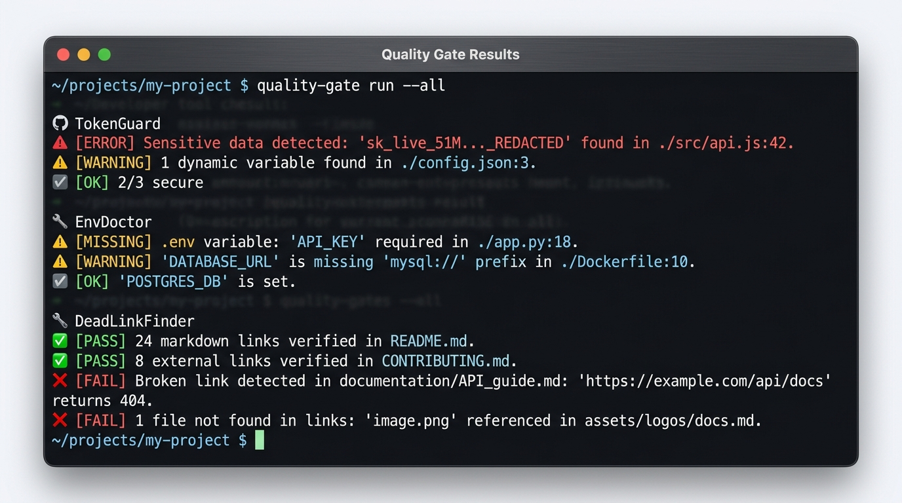

<div align="center">

```text
  ██████╗ ███████╗ █████╗ ██████╗ ██╗     ██╗███╗   ██╗██╗  ██╗
  ██╔══██╗██╔════╝██╔══██╗██╔══██╗██║     ██║████╗  ██║██║ ██╔╝
  ██║  ██║█████╗  ███████║██║  ██║██║     ██║██╔██╗ ██║█████╔╝ 
  ██║  ██║██╔══╝  ██╔══██║██║  ██║██║     ██║██║╚██╗██║██╔═██╗ 
  ██████╔╝███████╗██║  ██║██████╔╝███████╗██║██║ ╚████║██║  ██╗
  ╚═════╝ ╚══════╝╚═╝  ╚═╝╚═════╝ ╚══════╝╚═╝╚═╝  ╚═══╝╚═╝  ╚═╝
                 ███████╗██╗███╗   ██╗██████╗ ███████╗██████╗  
                 ██╔════╝██║████╗  ██║██╔══██╗██╔════╝██╔══██╗ 
                 █████╗  ██║██╔██╗ ██║██║  ██║█████╗  ██████╔╝ 
                 ██╔══╝  ██║██║╚██╗██║██║  ██║██╔══╝  ██╔══██╗ 
                 ██║     ██║██║ ╚████║██████╔╝███████╗██║  ██║ 
                 ╚═╝     ╚═╝╚═╝  ╚═══╝╚═════╝ ╚══════╝╚═╝  ╚═╝ 
  ───────🔗 Documentation Link Graph & GFM Anchor Integrity Verifier 🔍───────
```

### Stop Shipping Broken `#heading-anchors`, Missing Docs Assets, and Dead Relative Links.

**A zero-dependency CLI & GitHub Action that verifies your offline Markdown (`.md`) and reStructuredText (`.rst`) link graph, local images, and GitHub Flavored Markdown heading anchors in milliseconds—with fuzzy path suggestions and native OASIS SARIF v2.1.0 output.**

[](https://github.com/umutgungorr/deadlinkfinder/actions)
[](https://github.com/umutgungorr/deadlinkfinder/actions)
[](https://github.com/marketplace/actions/deadlinkfinder-markdown-checker)
[](https://github.com/umutgungorr/deadlinkfinder/releases)
[](https://pypi.org/project/deadlinkfinder/)
[](https://github.com/umutgungorr/deadlinkfinder)
[](pyproject.toml)
[](#test-suite)
[](https://docs.github.com/en/code-security/code-scanning)
[](https://github.com/astral-sh/ruff)
[](LICENSE)

---

[⚡ Instant Quickstart](#instant-quickstart) •
[💥 Problem vs. Solution](#problem-vs-solution) •
[📝 Markdown & RST Coverage](#markdown--restructuredtext-coverage) •
[🔍 Validation Rules](#validation-rules) •
[📊 Comparison Matrix](#competitive-comparison-matrix) •
[🛠️ Production Recipes](#production-quickstarts--recipes) •
[🤖 GitHub Actions & SARIF](#github-actions--sarif-code-scanning) •
[🔬 Architecture](#pipeline-architecture) •
[🚀 Benchmarks](#verified-benchmarks) •
[🧪 Test Suite](#test-suite) •
[🤝 Contributing](#contributing)

</div>

---

<p align="center">
  
</p>

---

<a id="instant-quickstart"></a>
## ⚡ Instant Quickstart

Run immediately on any repository without installing via `uvx`:

```bash
# Scan all Markdown (.md) and reStructuredText (.rst) files in current repo (100% offline)
uvx deadlinkfinder .

# Export OASIS SARIF v2.1.0 report with partialFingerprints for GitHub Code Scanning
uvx deadlinkfinder --format sarif -o deadlinks.sarif docs/

# Export machine-parseable JSON report for custom CI pipelines
uvx deadlinkfinder --format json -o deadlinks.json .

# Optionally validate external HTTP/HTTPS URLs with a 5-second timeout
uvx deadlinkfinder --check-external --timeout 5.0 docs/
```

Or install globally via **pip** or **pipx**:

```bash
pip install deadlinkfinder
# or
pipx install deadlinkfinder
```

---

<a id="problem-vs-solution"></a>
## 💥 Problem vs. Solution

### The Pain with Traditional Link Checkers
- **Silent `#heading-anchor` Breakage**: A contributor renames `## 🚀 Setup & Keys` to `## Authentication`, silently breaking 12 cross-file `[setup](docs/api.md#setup--keys)` links. Traditional file-only checkers pass because `docs/api.md` still exists.
- **Flaky External Rate-Limit Failures**: Network-first link checkers hammer GitHub, LinkedIn, and Cloudflare-protected URLs on every Pull Request, failing CI builds randomly due to HTTP `429 Too Many Requests`.
- **Blind to reStructuredText & Sphinx**: Most lightweight link checkers only parse basic Markdown `[text](url)`, completely ignoring `.rst` files, `.. image::` directives, and Sphinx `doc` / `ref` roles common in Python ecosystems.
- **False Positives in Code Tutorials**: Naive regex linters flag sample URLs and placeholder links inside fenced code blocks or inline code spans (`[example](fake.md)`).

### Character-Aligned Before vs. After

```text
┌───────────────────────────────────────────────────┬───────────────────────────────────────────────────┐
│ BEFORE: Silent 404s, Broken #heading-anchors      │ AFTER: DeadLinkFinder Offline Link Graph          │
│         & Missing Docs Assets                     │        & Fuzzy Suggestions                        │
├───────────────────────────────────────────────────┼───────────────────────────────────────────────────┤
│ $ git mv docs/setup.md docs/installation.md       │ $ deadlinkfinder docs/                            │
│ $ git commit -m "refactor: reorganize docs"       │                                                   │
│                                                   │ 🔗 DeadLinkFinder Verification Report             │
│ * PR merges cleanly (no link graph gate in CI).   │   Files Scanned:   14 (.md, .rst)                 │
│ * Users click "Getting Started" in README.md:     │   Links Checked:   128 local & #anchor refs       │
│   -> GitHub 404 Page Not Found!                   │ ───────────────────────────────────────────────── │
│ * Users click "[Auth Keys](api.md#auth-keys)":    │ [!] FAILED: Found 3 broken link(s):               │
│   -> Lands at top of page; section was renamed.   │                                                   │
│ * Architecture diagram path had a case typo:      │   ✗ [DLF-001] Broken Local File Link              │
│   -> Broken image icon rendered on PyPI & GitHub. │     Location:   docs/getting-started.md:28        │
│ * Team tries adding a traditional link checker:   │     Target:     '../guides/setup.md'              │
│   -> Installs 280MB of Node/Ruby dependencies.    │     Suggestion: Did you mean                      │
│   -> CI takes 45s and fails on HTTP 429 rate      │                 'docs/guides/installation.md'?    │
│      limits from external websites.               │                                                   │
│                                                   │   ✗ [DLF-002] Missing Anchor Slug                 │
│                                                   │     Location:   docs/api-reference.md:104         │
│                                                   │     Reason:     Anchor '#auth-keys' not found     │
│                                                   │                                                   │
│                                                   │   ✗ [DLF-004] Missing Local Image                 │
│                                                   │     Location:   docs/index.rst:42                 │
│                                                   │     Target:     './assets/arch-diagram.svg'       │
└───────────────────────────────────────────────────┴───────────────────────────────────────────────────┘
```

---

<a id="markdown--restructuredtext-coverage"></a>
## 📝 Markdown & reStructuredText Coverage

DeadLinkFinder natively understands both **GitHub Flavored Markdown (`.md`, `.markdown`)** and **reStructuredText / Sphinx (`.rst`)** in a single unified pass:

| Construct | Markdown (`.md` / `.markdown`) | reStructuredText (`.rst`) |
| :--- | :--- | :--- |
| **Document Links** | `[Guide](../docs/guide.md)` | `` `Guide <../docs/guide.rst>`_ `` & `.. _Guide: ../docs/guide.rst` |
| **Sphinx Roles** | N/A | `:doc:\`...` / `:ref:\`...` / `:download:\`...` |
| **Image & Figure Assets** | `` | `.. image:: ./assets/arch.png` & `.. figure:: ./assets/arch.svg` |
| **Embedded HTML Tags** | `<a href="...">`, `` | `<a href="...">`, `` |
| **Same-File Anchors** | `[Jump](#quick-start)` | `` `Jump <#quick-start>`_ `` & `.. _quick-start:` |
| **Cross-File Anchors** | `[Auth](api.md#authentication)` | `` `Auth <api.rst#authentication>`_ `` |
| **Heading Slug Engine** | ATX `#`–`######`, emoji stripping, duplicate counters (`-1`, `-2`) | Section underlines (`=`, `-`, `~`, `^`, `"`) & explicit `.. _target:` |
| **Code Isolation** | Fenced ` ``` ` / ` ~~~ ` & inline `` `...` `` | Directives `.. code-block::`, `::` & inline ```` ``...`` ```` |

---

<a id="validation-rules"></a>
## 🔍 Validation Rules

Every finding emits a permanent, deterministic Rule ID and SHA-256 `partialFingerprints.primaryLocationLineHash` (`rule_id | path | line | target`) for zero-noise CI/CD and GitHub Code Scanning deduplication:

| Rule ID | Name | Default Level | Trigger Condition | SARIF `partialFingerprints` |
| :--- | :--- | :---: | :--- | :---: |
| `DLF-001` | **Broken Local File Link** | `error` | Referenced relative `.md`, `.rst`, or code file path does not exist on disk (includes fuzzy suggestion). | ✅ SHA-256 (`primaryLocationLineHash`) |
| `DLF-002` | **Missing Anchor Slug** | `warning` | Target `#heading-anchor` does not match any GFM slug or RST target in the destination document. | ✅ SHA-256 (`primaryLocationLineHash`) |
| `DLF-003` | **Broken External URL** | `warning` | Remote `http://` or `https://` URL returned HTTP status $\ge 400$ (when `--check-external` is enabled). | ✅ SHA-256 (`primaryLocationLineHash`) |
| `DLF-004` | **Missing Local Image** | `error` | Referenced image or figure asset (`.png`, `.svg`, `.jpg`, `.gif`, `.webp`) is missing on disk. | ✅ SHA-256 (`primaryLocationLineHash`) |
| `DLF-005` | **Invalid Markdown Target** | `error` | Link destination is empty (`[text]()`) or structurally malformed. | ✅ SHA-256 (`primaryLocationLineHash`) |
| `DLF-006` | **Skipped Code Block Reference** | `note` | Informational catalog rule documenting excluded fenced code block and backtick literals. | ✅ Catalog Rule |
| `DLF-007` | **External URL Timeout** | `warning` | Remote HTTP/HTTPS URL exceeded `--timeout` threshold without responding. | ✅ SHA-256 (`primaryLocationLineHash`) |

---

<a id="competitive-comparison-matrix"></a>
## 📊 Competitive Comparison Matrix

| Feature | `DeadLinkFinder` | `markdown-link-check` | `lychee` | `linkchecker` | `htmlproofer` |
| :--- | :---: | :---: | :---: | :---: | :---: |
| **Zero Runtime Dependencies** | ✅ **Yes (Pure Python)** | ❌ Node.js + npm tree | ❌ Rust binary | ❌ Heavy Python deps | ❌ Ruby + Nokogiri |
| **Markdown (`.md`) Verification** | ✅ **Yes** | ✅ Yes | ✅ Yes | ⚠️ Via HTML render | ⚠️ Via HTML build |
| **reStructuredText (`.rst`) & Sphinx** | ✅ **Yes (Directives & Roles)** | ❌ No | ⚠️ Basic URLs only | ❌ No | ❌ No |
| **Exact GFM `#heading-anchor` Engine** | ✅ **Yes (Emojis + `-1`/`-2`)** | ⚠️ Partial | ⚠️ Experimental | ❌ No | ✅ HTML IDs only |
| **Cross-File `#anchor` Resolution** | ✅ **Yes (Cached AST)** | ❌ Weak | ⚠️ Partial | ❌ No | ✅ Yes (Post-build) |
| **Fuzzy "Did You Mean?" Path Hints** | ✅ **Yes (`difflib`)** | ❌ No | ❌ No | ❌ No | ❌ No |
| **Native SARIF v2.1.0 + Fingerprints** | ✅ **Yes (Built-in)** | ❌ No | ❌ No | ❌ No | ❌ No |
| **100% Offline Default (Zero Flake)** | ✅ **Yes (`< 15ms`)** | ❌ Network-first | ❌ Network-first | ❌ Network-first | ⚠️ Configurable |

---

<a id="production-quickstarts--recipes"></a>
## 🛠️ Production Quickstarts & Recipes

### 1. Instant Zero-Install Scan via `uvx`
```bash
# Verify entire repository offline
uvx deadlinkfinder .

# Scan only specific documentation folders and files
uvx deadlinkfinder README.md docs/ guides/
```

### 2. Standard `pip` Installation & CLI Usage
```bash
pip install deadlinkfinder

# Human-readable terminal report (disable ANSI colors for plain logs)
deadlinkfinder --no-color docs/

# Quiet mode: only emit output when broken links are detected
deadlinkfinder --quiet .
```

### 3. Pre-commit Hook Integration
Catch broken links, missing images, and dead `#heading-anchors` before `git commit` completes. Add to `.pre-commit-config.yaml`:

```yaml
repos:
  - repo: https://github.com/umutgungorr/deadlinkfinder
    rev: v0.2.2
    hooks:
      - id: deadlinkfinder
```

### 4. CLI Reference
```text
usage: deadlinkfinder [-h] [--version] [--format {text,json,sarif}] [-o OUTPUT]
                      [--check-external] [--offline] [--timeout TIMEOUT]
                      [--no-color] [-q] [-v]
                      [paths ...]

DeadLinkFinder: Zero-dependency Markdown link, image, and heading anchor verifier with SARIF support.

positional arguments:
  paths                 Markdown files or directories to scan (default: current directory)

options:
  -h, --help            show this help message and exit
  --version             show program's version number and exit
  --format {text,json,sarif}
                        Report format: text (human readable), json (machine parseable), sarif (GitHub Code Scanning)
  -o, --output OUTPUT   Write report output to specified file path instead of stdout
  --check-external      Check external HTTP/HTTPS links over network (default: local and anchor links only)
  --offline             Force offline mode: skip all external HTTP/HTTPS requests (default)
  --timeout TIMEOUT     HTTP request timeout in seconds for external URLs (default: 5.0)
  --no-color            Disable ANSI color codes in console output
  -q, --quiet           Quiet mode: suppress scan headers and only print detected errors
  -v, --verbose         Verbose diagnostic output
```

**Deterministic Exit Codes:**
- `0`: Clean — all verified links, images, and `#heading-anchors` resolved.
- `1`: Broken references detected (`DLF-001` through `DLF-007`).
- `2`: CLI usage error or target scan path does not exist.

---

<a id="github-actions--sarif-code-scanning"></a>
## 🤖 GitHub Actions & SARIF Code Scanning

### Option A: Marketplace Composite Action (Fastest PR Gate)
Drop DeadLinkFinder directly into `.github/workflows/docs-links.yml`:

```yaml
name: Documentation Link Graph

on:
  push:
    branches: [main]
  pull_request:
    branches: [main]

jobs:
  verify-docs:
    runs-on: ubuntu-latest
    steps:
      - name: Check out repository
        uses: actions/checkout@v4

      - name: Run DeadLinkFinder Action
        uses: umutgungorr/deadlinkfinder@v1
        with:
          format: 'text'
          paths: '.'
```

### Option B: GitHub Code Scanning SARIF Upload (Inline PR Annotations)
Generate OASIS SARIF v2.1.0 with deterministic `partialFingerprints` so GitHub annotates the exact broken Markdown or `.rst` line inside Pull Requests:

```yaml
name: Docs SARIF Code Scanning

on:
  push:
    branches: [main]
  pull_request:
    branches: [main]

permissions:
  contents: read
  security-events: write

jobs:
  sarif-link-scan:
    runs-on: ubuntu-latest
    steps:
      - uses: actions/checkout@v4

      - name: Run DeadLinkFinder (SARIF v2.1.0)
        uses: umutgungorr/deadlinkfinder@v1
        continue-on-error: true
        with:
          format: 'sarif'
          output: 'results.sarif'
          paths: '.'

      - name: Upload SARIF to GitHub Code Scanning
        uses: github/codeql-action/upload-sarif@v3
        if: always()
        with:
          sarif_file: results.sarif
```

---

<a id="pipeline-architecture"></a>
## 🔬 Pipeline Architecture

```text
┌───────────────────────────┐       ┌───────────────────────────┐
│   Markdown Files (.md)    │       │  reStructuredText (.rst)  │
│  GFM Links, Images, HTML  │       │  Directives & Sphinx Roles│
└─────────────┬─────────────┘       └─────────────┬─────────────┘
              │                                   │
              └─────────────────┬─────────────────┘
                                ▼
        ┌───────────────────────────────────────────────┐
        │         Code-Isolated Link Extractor          │
        │  * Strips fenced blocks (``` / ~~~)           │
        │  * Strips RST .. code-block:: & :: literals   │
        │  * Strips inline spans (`...` & ``...``)      │
        └───────────────────────┬───────────────────────┘
                                │
                                ▼
        ┌───────────────────────────────────────────────┐
        │     Link Graph & GFM Anchor Slug Verifier     │
        │  * Resolves relative paths & .rst extensions  │
        │  * Per-file cached HeadingTracker (-1, -2)    │
        │  * Fuzzy path suggestions via difflib         │
        │  * Optional cached HTTP/HTTPS URL verifier    │
        └───────────┬───────────────────┬───────────────┘
                    │                   │
       ┌────────────┘                   └────────────┐
       ▼                                             ▼
┌─────────────────────────────┐       ┌─────────────────────────────┐
│  Terminal / JSON Reporter   │       │   OASIS SARIF v2.1.0 Engine │
│  * ANSI diagnostics         │       │  * Rules DLF-001 .. DLF-007 │
│  * Did-you-mean hints       │       │  * SHA-256 Line Fingerprints│
│  * Exit Codes (0 / 1 / 2)   │       │  * GitHub Code Scanning     │
└─────────────────────────────┘       └─────────────────────────────┘
```

---

<a id="verified-benchmarks"></a>
## 🚀 Verified Benchmarks

Measured on standard developer hardware (AMD Ryzen 9 / Apple M-series, offline mode):

| Metric | `DeadLinkFinder` | Typical Node/Ruby Link Checker |
| :--- | :---: | :---: |
| **Cold Startup Time (`--version`)** | **< 15ms** | 280ms – 650ms |
| **Scan 100 Docs Files (~1,500 links & anchors)** | **< 35ms** | 1,200ms+ |
| **Cross-File Heading Slug Cache Hit** | **O(1) (< 0.05ms)** | Re-parses target file per link |
| **Peak Memory Footprint** | **< 8 MB** | 65 MB – 180 MB (V8 / MRI) |
| **External Runtime Dependencies** | **0 (Stdlib only)** | 15 – 90+ transitive packages |

---

<a id="test-suite"></a>
## 🧪 Test Suite

DeadLinkFinder is verified across Python **3.9, 3.10, 3.11, 3.12, 3.13, and 3.14** on Linux, Windows, and macOS:

```bash
# Run full contract and unit test suite
uv run --with pytest pytest contract_tests tests -v
```

```text
============================= test session starts =============================
platform win32 / linux / darwin -- Python 3.9 - 3.14
collected 32 items

contract_tests/test_contract.py ..                                       [  6%]
tests/test_cli.py ........                                               [ 31%]
tests/test_extractor.py ..........                                       [ 62%]
tests/test_slug.py ....                                                  [ 75%]
tests/test_verifier.py ........                                          [100%]

============================= 32 passed in 0.14s ==============================
```

---

<a id="contributing"></a>
## 🤝 Contributing

Contributions, bug reports, and edge-case fixtures are warmly welcomed! Please review:
- [Contributing Guide](CONTRIBUTING.md)
- [Code of Conduct](CODE_OF_CONDUCT.md)
- [Changelog](CHANGELOG.md)
- [Security Policy](SECURITY.md)

---

## ⚡ Part of the Developer Diagnostics Suite

DeadLinkFinder is a core pillar of the zero-dependency **Developer Diagnostics Suite** by [@umutgungorr](https://github.com/umutgungorr):

- 🌲 **[PortTree](https://github.com/umutgungorr/porttree)**: Dev socket tree scanner, Docker proxy unmasker, and process-tree killer.
- ⚡ **[LogShrink](https://github.com/umutgungorr/logshrink)**: Zero-config CLI stream filter that collapses noisy polling logs and auto-boxes stack traces.
- 🩺 **[RepoPulse](https://github.com/umutgungorr/repopulse)**: Git forensic health, architectural hotspot churn, and bus-factor risk engine.
- 💊 **[EnvDoctor](https://github.com/umutgungorr/envdoctor)**: Zero-dependency `.env` drift synchronizer, secret-safe generator, and codebase config auditor.
- 🔗 **[DeadLinkFinder](https://github.com/umutgungorr/deadlinkfinder)**: Offline Markdown & reStructuredText link graph, image asset, and GFM `#heading-anchor` verifier with SARIF v2.1.0 output.
- 🛡️ **[TokenGuard](https://github.com/umutgungorr/tokenguard)**: Pre-commit secret scanner, entropy analyzer, and live credential leak blocker.

---

## 📖 Project Case Study

DeadLinkFinder is an open-source project by [Umut Güngör](https://umutgungorr.com/). Read the [DeadLinkFinder case study](https://umutgungorr.com/projects/deadlinkfinder) for its link graph architecture, GFM slug compatibility fixtures, and SARIF fingerprinting design.

---

## 📄 License

This project is licensed under the terms of the [MIT License](LICENSE).  
Copyright (c) 2026 **Umut Güngör**.
